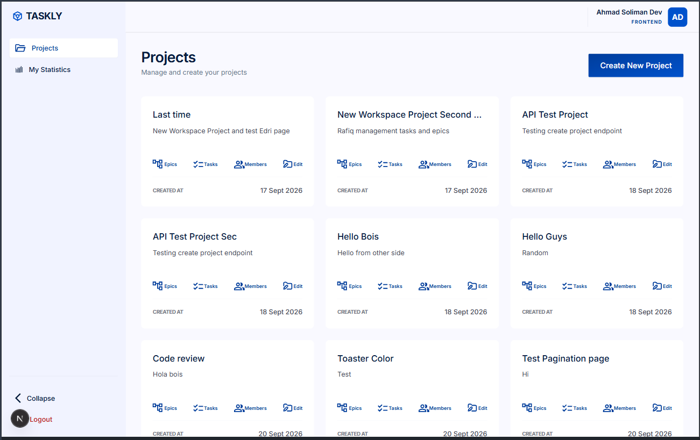
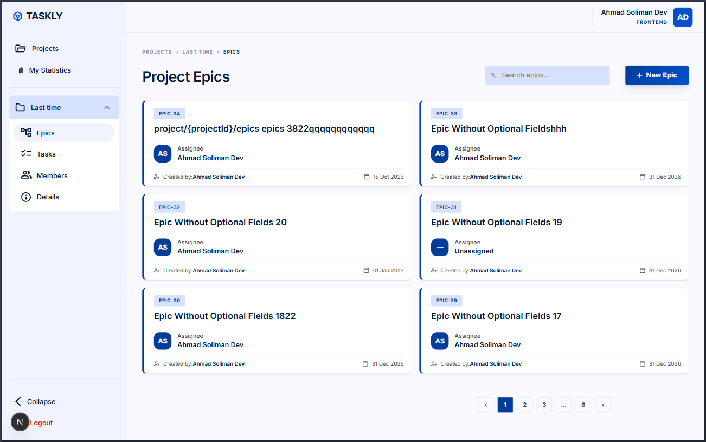
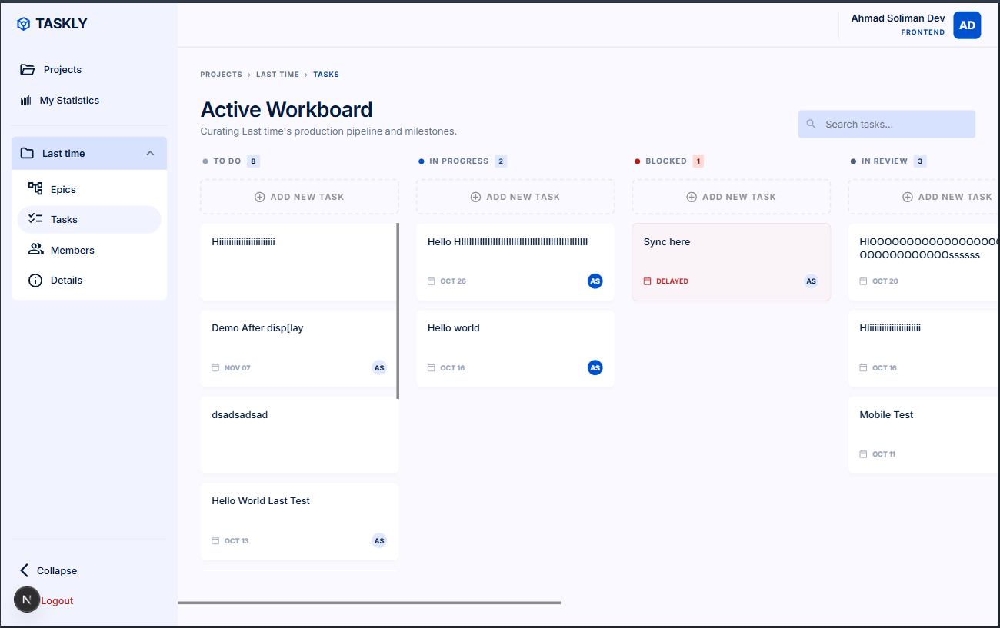
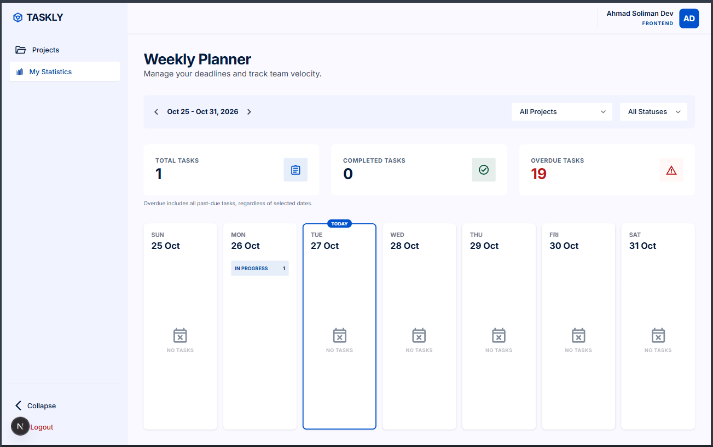
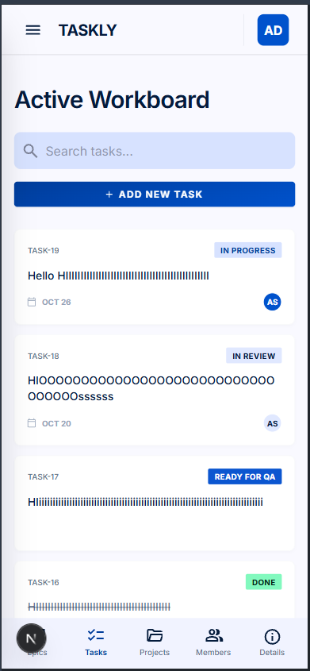
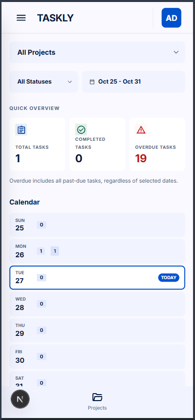

# Taskly

Taskly is a responsive task and project management application for organizing projects, coordinating members, and tracking work from planning through completion. Inspired by workflows found in tools such as ClickUp, it explores a focused set of project management features as a frontend training and portfolio project.

Built with Next.js App Router, React, and TypeScript, the application connects a responsive interface to a Supabase backend through Next.js API routes.

## Key features

- **Account flows:** sign up, log in, remember your session, log out, and recover or reset a password.
- **Projects:** create and edit project details, browse paginated project cards, and access project-specific workspaces.
- **Members and invitations:** view project members and roles, send email invitations, and accept invitations through a flow that preserves the destination during login or signup.
- **Epics:** create and browse epics, edit their details, assign members and deadlines, and view or create associated tasks.
- **Task creation and editing:** open task details and update titles, descriptions, assignees, due dates, epic associations, and statuses.
- **Task search:** search project tasks by title with debounced requests and pagination.
- **Drag and drop:** move tasks between workflow statuses on the desktop board or use mobile touch dragging with status targets. Keyboard controls support picking up, moving, dropping, and canceling a task move.
- **Workflow visibility:** track eight statuses, from To Do and In Progress through review, QA, and Done, with assignee information on task cards.
- **My Statistics:** explore task totals, completed and overdue counts, a calendar, status breakdowns, and counts per project. Calendar statistics support date, project, and status filters.
- **Responsive UI:** desktop sidebar and board layouts adapt to a mobile drawer, bottom navigation, and task list. Loading skeletons, empty states, validation feedback, retry actions, and toast notifications support data-driven flows.

## Screenshots

### Desktop

**Projects overview** — Project cards with shortcuts to epics, tasks, members, and details.



**Epics management** — Project epics with assignees, deadlines, search, and pagination.



**Tasks board** — Tasks organized into horizontally scrollable workflow columns.



**My Statistics** — Weekly task counts, filters, and calendar summaries.



### Mobile

The responsive tasks view and statistics dashboard adapt to a narrow viewport.

<p>
  
  
</p>

_Left: Tasks with search and status labels. Right: My Statistics with filters and a daily calendar._

## Technology stack

| Area                 | Technologies                                                              |
| -------------------- | ------------------------------------------------------------------------- |
| Application          | Next.js 16 App Router, React 19, TypeScript                               |
| Styling              | Tailwind CSS 4, CSS design tokens, `tailwind-merge`                       |
| Backend              | Supabase Auth, PostgREST, and database RPCs, accessed with native `fetch` |
| Forms and validation | React Hook Form, Zod, `@hookform/resolvers`                               |
| Interactions         | `@dnd-kit/react`, `@dnd-kit/dom`, Sonner                                  |
| Quality and assets   | Vitest, ESLint, Prettier, SVGR for SVG React components                   |

## Architecture

```text
Browser -> Next.js server / API boundary -> Supabase
```

App Router layouts handle server-side session checks, while Client Components handle forms, dialogs, navigation, and interactive boards. Browser data requests go through same-origin Next.js API routes. Server code reads the Supabase secret and forwards authenticated requests to Supabase; session tokens are stored in HTTP-only cookies.

Features own their components, hooks, schemas, and mapping utilities. React state and custom hooks manage loading, errors, pagination, canceled or stale requests, and mutation feedback. Task status moves use optimistic UI updates followed by server reconciliation. Zod validates forms and API payloads; typed mappers handle other response shapes. Native `fetch` keeps requests explicit without an additional API client or global state library.

```text
src/
  app/          # Auth/protected routes, layouts, and API handlers
  features/     # Auth, projects, epics, tasks, invitations, statistics
  components/   # UI primitives and shared authenticated shell
  lib/          # Session/cookie utilities and class-name helper
  config/       # Shared navigation definitions
  styles/       # Design tokens
  assets/       # SVG assets
tests/          # API regressions and browser focus fixtures
```

See [shared components](docs/shared-components.md) for the reusable UI structure. The server boundary keeps credentials out of browser code; the database authorization limitations below still apply.

## Getting started

### Prerequisites

- **Node.js 24** is recommended for compatibility with the current application and Vitest tooling.
- **pnpm 11.23.0**, pinned in [package.json](package.json).
- A **compatible configured Supabase backend**, including the expected tables, views, RPCs, and authentication settings.

The repository does **not** bundle a complete database schema, migrations, or reproducible Supabase setup. Cloning and starting the frontend alone does not provide a working backend. Account recovery and email invitations also depend on the backend's email and redirect settings.

### Local setup

1. Clone the repository and enter its directory:

   ```sh
   git clone https://github.com/A7madSoliman/rafiq-tasks-management-system.git
   cd rafiq-tasks-management-system
   ```

2. Install the pinned package manager if needed, then install dependencies:

   ```sh
   npm install --global pnpm@11.23.0
   pnpm install --frozen-lockfile
   ```

3. Copy [.env.example](.env.example) to `.env.local` and fill in your backend configuration:

   ```sh
   cp .env.example .env.local
   ```

   In PowerShell, use `Copy-Item .env.example .env.local`.

   | Variable              | Purpose                                                                                                           |
   | --------------------- | ----------------------------------------------------------------------------------------------------------------- |
   | `SUPABASE_URL`        | URL of the compatible Supabase project.                                                                           |
   | `SUPABASE_SECRET_KEY` | Supabase secret used only by server-side code. Keep it out of client code, public environment variables, and Git. |
   | `APP_URL`             | Application origin used to construct invitation links; use `http://localhost:3000` locally.                       |

   Configure Supabase authentication redirects for the local password recovery flow at `http://localhost:3000/reset-password`.

4. Start the development server:

   ```sh
   pnpm dev
   ```

5. Open [http://localhost:3000](http://localhost:3000).

### Available scripts

| Command          | Purpose                                                |
| ---------------- | ------------------------------------------------------ |
| `pnpm dev`       | Start the Next.js development server.                  |
| `pnpm build`     | Create the production build.                           |
| `pnpm start`     | Serve the production build after running `pnpm build`. |
| `pnpm lint`      | Run ESLint.                                            |
| `pnpm typecheck` | Run TypeScript without emitting files.                 |
| `pnpm test`      | Run the Vitest suite once.                             |
| `pnpm format`    | Format the repository with Prettier.                   |

## Testing and quality

Vitest runs in a Node environment with tests alongside features and under [tests](tests). The suite covers validation and mapping utilities, pagination and search, hook state transitions, task edits and moves, invitation flows, statistics, and API boundaries. API tests use mocked authentication and upstream responses rather than a live Supabase database.

A focused Chromium fixture also tests drawer and Epic dialog focus behavior using real React components and keyboard events. These cases use an installed Chrome, Edge, or Chromium executable, or a path supplied through `TASKLY_BROWSER_PATH`; they are skipped when no supported browser is found. This fixture is separate from full application end-to-end testing.

Run the quality checks with:

```sh
pnpm lint
pnpm typecheck
pnpm test
pnpm build
```

Manual browser QA remains necessary for full application visuals, real-device touch interactions, email flows, and integration with a configured backend. Automated checks do not establish accessibility certification or production readiness.

## Known limitations

- Taskly is a training and portfolio project.
- Existing Supabase row-level security (RLS) and `SECURITY DEFINER` authorization limitations require remediation before production or public use with real data. Application-level checks do not replace database authorization.
- Full backend setup is not bundled with this frontend repository.
- Overdue statistics follow the existing backend semantics and are independent of the selected date range. Overdue counts can exceed the selected range's total task count.

## Design and credits

The interface follows the [Taskly Figma design reference](https://www.figma.com/design/JKBfMPiHdHJVZmBa1Cttpo/Taskly--Tasks-Management---Copy-). This is a design reference, not a screenshot of the running application. Design authorship and reuse licensing have not been verified.
